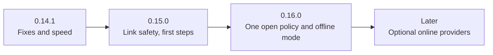

# Junction roadmap

Updated: 15 November 2026. The current release is 0.14.0.

This file lists the next work for each version. Research for the link-safety work is in [url-reputation.md](url-reputation.md).

## 0.14.1: fixes and speed

Status: merged in [#73](https://github.com/TheTobiGit/junction/pull/73). All 539 tests pass. A second agent reviewed the changes and closed three findings. The Focus badge finding stays open on purpose (see Known issues).

| Area | Problem | Fix |
|---|---|---|
| Preview | A link that redirects reloads the preview without end (190 loads in 8 seconds for one test link) | The preview loads each requested URL one time |
| Microsoft Safe Links | Junction did not unwrap Safe Links, and it changed `%2B` to `+` in the query | Junction unwraps `*.safelinks.protection.outlook.com` and `*.safelinks.protection.office365.us`. Cleaning keeps the original encoding |
| Remember my choice | For a wrapped link, the rule used the wrapper host | The rule uses the real target host |
| Targets | The picker showed other Junction builds as targets | Junction hides every `dev.gideonsarfo.Junction*` app |
| Speed | Each link scanned all browsers and profiles on disk and loaded every icon again | Junction keeps the browser list in memory and scans again in the background. Icons are kept in memory. Picker open time in the app went from 115 to 425 ms to about 60 ms |
| Preview | Video and audio started without a click | Media starts only after a click |
| Focus | Each link read the macOS Focus file, which macOS can block | Junction reads the file only when a rule uses Focus |
| Cleaning | Encoded tracker names such as `%75tm_source` stayed in the link | Junction decodes names before it compares them |

## 0.15.0: link safety, first steps

Goal: give a warning for known bad links. Junction must not send a link to a service unless the user clicks.

| Item | What to build | Network use |
|---|---|---|
| Check before preview | Run the risk check before the picker loads the page title, icon or preview. Today the picker contacts the site as soon as it opens | None |
| VirusTotal button | A picker action that opens the VirusTotal report page for the link in the browser. No API key | Only when the user clicks |
| urlscan.io button | A picker action that opens an urlscan.io search for the host. No API key | Only when the user clicks |
| URLhaus list | Download the URLhaus malware link list on a schedule. Check each link against the copy on the Mac. A match shows on the risk chip | List download only. The check is local |
| README wording | The README says "no network call". The preview, the icons (through DuckDuckGo) and the shortener expansion use the network. Change the text to say what each feature sends | None |

Check before release: the URLhaus terms permit non-commercial use. Confirm the terms for a free desktop app.

## 0.16.0: one open policy and offline mode

| Item | What to build |
|---|---|
| One open policy | One check for every way Junction opens a link: picker, rules, app schemes, the `junction://` scheme, the CLI and the agent socket |
| Result states | `not checked`, `checking`, `listed`, `not listed`, `unknown`, `stale`, `error`. "Not listed" never means "safe" |
| List import | Import a list file. Record its source, licence, date and expiry. Keep the last good copy if an import fails |
| Strict offline mode | One setting that stops all network use: reputation, list updates, shortener expansion, preview, page titles and icons |
| CLI and socket | `junction inspect --json` adds the reputation result and `networkUsed`. Online checks need a separate, explicit option |

## Later: optional online providers

Each provider is off by default. The user gives an own API key. Junction shows what each provider receives before the user turns it on.

| Rank | Provider | Use | Limit |
|---|---|---|---|
| 1 | Google Safe Browsing v5 (local hash list) | Malware and phishing | Non-commercial use only |
| 2 | Google Web Risk | Commercial users | About 100,000 lookups a month free, then $0.50 per 1,000 |
| 3 | abuse.ch ThreatFox, Spamhaus DBL | Domain and server data | Terms and keys per user |
| 4 | VirusTotal API | Manual lookup | 4 requests a minute, 500 a day. No commercial use |
| 5 | urlscan.io, Cloudflare scanner | Manual page scan | The scan can be public. Never automatic |

## Known issues

| Issue | Note |
|---|---|
| The picker closes when another window takes focus, for example a firewall alert | This is by design. In preview, the pin button keeps the picker open. Think about a short grace period |
| Apps that are not browsers show as targets (ChatGPT, cmux, Parallels Desktop) | They register for web links. The user can hide them. Think about hiding apps that are not browsers by default |
| The first picker after launch takes about 1.5 seconds | Cause not confirmed. It can be the first SwiftUI render or a browser scan that has not finished. Profile it before a fix |
| The Focus badge shows only when a rule uses Focus | Junction reads the Focus file only when a rule uses Focus (`Sources/JunctionApp/System/FocusTracker.swift`). Without Full Disk Access, macOS also blocks that read |
| A "Data Access Blocked" banner shows for local preview builds | Cause not confirmed. Check again after the Focus change |
| Local ad-hoc builds show "Unable to Check For Updates" | The build has no Sparkle key. This affects development builds only |
